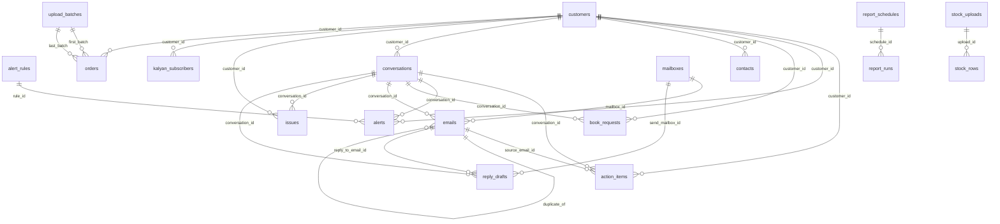

# Database: the PostgreSQL tables behind Gita Mail (Email Analytics)

Database `gitamail` on the server's PostgreSQL 18 (port 5432). The app creates and updates these tables itself: every change is a migration in `server/migrations.ts`, applied automatically when the service starts. Nothing here needs to be run by hand.

49 tables. The exact definitions (columns, keys, indexes) are in [database/schema.sql](database/schema.sql); this page explains them.

**To look at them on the server:** open SQL Shell (psql) and connect with `-U gitamail -h 127.0.0.1 -d gitamail`, then `\dt` lists the tables and `\d emails` shows one. In pgAdmin: Servers → PostgreSQL 18 → Databases → gitamail → Schemas → public → Tables.

**Read only, please.** Change data through the app: it keeps related tables consistent (a conversation's counts, a customer's health, the audit log). Back up with `pg_dump -U gitamail -h 127.0.0.1 -Fc gitamail > gitamail.backup`.

## Contents

- **Organisation and access:** [oauth_states](#oauth_states), [organisations](#organisations), [password_resets](#password_resets), [sessions](#sessions), [user_mailboxes](#user_mailboxes), [users](#users)
- **Mailboxes and email:** [conversation_keys](#conversation_keys), [conversation_notes](#conversation_notes), [conversations](#conversations), [emails](#emails), [mailboxes](#mailboxes), [sync_runs](#sync_runs)
- **Customers:** [contacts](#contacts), [customer_health_daily](#customer_health_daily), [customer_phones](#customer_phones), [customer_reviews](#customer_reviews), [customers](#customers)
- **Analysis:** [action_items](#action_items), [ai_state](#ai_state), [ai_usage](#ai_usage), [analytics_runs](#analytics_runs), [issues](#issues), [purpose_defs](#purpose_defs), [purpose_retags](#purpose_retags), [worker_lease](#worker_lease)
- **Replies:** [attachments](#attachments), [reference_items](#reference_items), [reply_drafts](#reply_drafts), [reply_templates](#reply_templates)
- **Alerts and reports:** [alert_rules](#alert_rules), [alerts](#alerts), [audit_log](#audit_log), [report_runs](#report_runs), [report_schedules](#report_schedules)
- **Books, stock and inventory:** [book_requests](#book_requests), [book_titles](#book_titles), [catalogues](#catalogues), [stock_files](#stock_files), [stock_rows](#stock_rows), [stock_uploads](#stock_uploads)
- **Uploads, orders and Kalyan:** [kalyan_dispatches](#kalyan_dispatches), [kalyan_stage](#kalyan_stage), [kalyan_subscribers](#kalyan_subscribers), [order_status_history](#order_status_history), [orders](#orders), [upload_batches](#upload_batches), [upload_file_parts](#upload_file_parts), [upload_stage](#upload_stage)
- **System:** [schema_migrations](#schema_migrations)

## How the main tables connect

Almost every table also has `org_id` (the organisation) and many have a user column (who did it); those links are left out of the diagram.

## Organisation and access

### oauth_states

Short-lived values that protect the Google (or Microsoft) sign-in and mailbox-connection redirects.

| Column | Type | Required | Default | Links to |
|---|---|---|---|---|
| `state` | text | yes |  |  |
| `user_id` | bigint |  |  | → users(id) (on delete cascade) |
| `provider` | text | yes |  |  |
| `payload` | jsonb | yes | `'{}'` |  |
| `created_at` | timestamp with time zone | yes | `now()` |  |

Primary key: (state)  

### organisations

The organisation (Gita Press, Gorakhpur): its name, the internal email domains (whose senders count as staff) and the `settings` object behind the Settings page: reply SLA, health window, reference information for replies, signature, footer, retention, automatic drafts.

| Column | Type | Required | Default | Links to |
|---|---|---|---|---|
| `id` | bigint | yes | `nextval('organisations_id_seq')` |  |
| `name` | text | yes |  |  |
| `internal_domains` | text[] | yes | `'{}'` |  |
| `settings` | jsonb | yes | `'{}'` |  |
| `created_at` | timestamp with time zone | yes | `now()` |  |

Primary key: (id)  

### password_resets

One-time links for password reset and for inviting a user.

| Column | Type | Required | Default | Links to |
|---|---|---|---|---|
| `id` | bigint | yes | `nextval('password_resets_id_seq')` |  |
| `user_id` | bigint | yes |  | → users(id) (on delete cascade) |
| `token_hash` | text | yes |  |  |
| `expires_at` | timestamp with time zone | yes |  |  |
| `used_at` | timestamp with time zone |  |  |  |
| `created_at` | timestamp with time zone | yes | `now()` |  |

Primary key: (id)  

### sessions

Sign-in sessions, kept on the server so a session can be revoked; they expire after 12 hours.

| Column | Type | Required | Default | Links to |
|---|---|---|---|---|
| `id` | uuid | yes | `gen_random_uuid()` |  |
| `user_id` | bigint | yes |  | → users(id) (on delete cascade) |
| `created_at` | timestamp with time zone | yes | `now()` |  |
| `expires_at` | timestamp with time zone | yes |  |  |
| `revoked_at` | timestamp with time zone |  |  |  |
| `ip_address` | text |  |  |  |
| `user_agent` | text |  |  |  |
| `iam_token_enc` | text |  |  |  |

Primary key: (id)  
Indexes: `sessions_user_idx`  

### user_mailboxes

Which mailboxes a user may see when they do not have access to all mailboxes.

| Column | Type | Required | Default | Links to |
|---|---|---|---|---|
| `user_id` | bigint | yes |  | → users(id) (on delete cascade) |
| `mailbox_id` | bigint | yes |  | → mailboxes(id) (on delete cascade) |

Primary key: (user_id, mailbox_id)  

### users

People who sign in: email, name, role (viewer, analyst, manager, admin), password hash or Google sign-in, time zone (used for digests and the quoted-email line), and whether they see all mailboxes.

| Column | Type | Required | Default | Links to |
|---|---|---|---|---|
| `id` | bigint | yes | `nextval('users_id_seq')` |  |
| `org_id` | bigint | yes |  | → organisations(id) (on delete cascade) |
| `email` | text | yes |  |  |
| `full_name` | text | yes | `''` |  |
| `role` | text | yes | `'viewer'` |  |
| `auth_provider` | text | yes | `'local'` |  |
| `external_id` | text |  |  |  |
| `password_hash` | text |  |  |  |
| `is_active` | boolean | yes | `true` |  |
| `all_mailboxes` | boolean | yes | `false` |  |
| `timezone` | text | yes | `'America/Toronto'` |  |
| `notify_email` | boolean | yes | `true` |  |
| `last_login_at` | timestamp with time zone |  |  |  |
| `created_at` | timestamp with time zone | yes | `now()` |  |
| `updated_at` | timestamp with time zone | yes | `now()` |  |
| `ms_object_id` | text |  |  |  |
| `email_aliases` | text[] | yes | `'{}'` |  |
| `digest_enabled` | boolean | yes | `true` |  |
| `last_digest_at` | timestamp with time zone |  |  |  |
| `ravity_space_key` | text |  |  |  |
| `google_sub` | text |  |  |  |

Primary key: (id)  
Checks: `auth_provider = ANY (['local', 'ravity', 'microsoft', 'google'])`; `role = ANY (['admin', 'manager', 'analyst', 'viewer'])`  
Indexes: `users_email_uq`, `users_google_sub_uq`  

## Mailboxes and email

### conversation_keys

Lookup keys (Gmail thread IDs, Message-IDs) that put each new email into the right conversation.

| Column | Type | Required | Default | Links to |
|---|---|---|---|---|
| `conversation_id` | bigint | yes |  | → conversations(id) (on delete cascade) |
| `key` | text | yes |  |  |

Primary key: (key)  
Indexes: `conv_keys_conv_idx`  

### conversation_notes

Internal notes staff write on a conversation.

| Column | Type | Required | Default | Links to |
|---|---|---|---|---|
| `id` | bigint | yes | `nextval('conversation_notes_id_seq')` |  |
| `conversation_id` | bigint | yes |  | → conversations(id) (on delete cascade) |
| `user_id` | bigint |  |  | → users(id) (on delete set null) |
| `body` | text | yes |  |  |
| `created_at` | timestamp with time zone | yes | `now()` |  |

Primary key: (id)  

### conversations

One row per email thread: the customer, the mailboxes involved, counts and timing (first and last message, awaiting reply), the AI analysis (group and subgroup, sentiment, red/amber/green and reason, urgency, summary, proposal stage) and the reasons for contacting (`purposes`).

| Column | Type | Required | Default | Links to |
|---|---|---|---|---|
| `id` | bigint | yes | `nextval('conversations_id_seq')` |  |
| `org_id` | bigint | yes |  | → organisations(id) (on delete cascade) |
| `customer_id` | bigint |  |  | → customers(id) (on delete set null) |
| `subject` | text | yes | `''` |  |
| `normalized_subject` | text | yes | `''` |  |
| `first_message_at` | timestamp with time zone |  |  |  |
| `last_message_at` | timestamp with time zone |  |  |  |
| `last_inbound_at` | timestamp with time zone |  |  |  |
| `last_outbound_at` | timestamp with time zone |  |  |  |
| `message_count` | integer | yes | `0` |  |
| `inbound_count` | integer | yes | `0` |  |
| `duplicate_count` | integer | yes | `0` |  |
| `mailbox_ids` | bigint[] | yes | `'{}'` |  |
| `participants` | text[] | yes | `'{}'` |  |
| `awaiting_reply` | boolean | yes | `false` |  |
| `first_response_minutes` | integer |  |  |  |
| `summary` | text |  |  |  |
| `sentiment` | text |  |  |  |
| `sentiment_score` | real |  |  |  |
| `rag` | text |  |  |  |
| `rag_reason` | text |  |  |  |
| `customer_state` | text |  |  |  |
| `urgency` | text |  |  |  |
| `escalation_risk` | integer |  |  |  |
| `priority_score` | integer | yes | `0` |  |
| `categories` | text[] | yes | `'{}'` |  |
| `topics` | text[] | yes | `'{}'` |  |
| `entities` | jsonb | yes | `'{}'` |  |
| `suggested_reply` | text |  |  |  |
| `analysis_model` | text |  |  |  |
| `analysed_at` | timestamp with time zone |  |  |  |
| `needs_analysis` | boolean | yes | `true` |  |
| `status` | text | yes | `'open'` |  |
| `assignee_id` | bigint |  |  | → users(id) (on delete set null) |
| `resolved_at` | timestamp with time zone |  |  |  |
| `created_at` | timestamp with time zone | yes | `now()` |  |
| `updated_at` | timestamp with time zone | yes | `now()` |  |
| `business_category` | text | yes | `'other'` |  |
| `is_internal` | boolean | yes | `false` |  |
| `is_automated` | boolean | yes | `false` |  |
| `staff_participants` | text[] | yes | `'{}'` |  |
| `proposal` | jsonb |  |  |  |
| `proposal_stage` | text |  |  |  |
| `proposal_stage_locked` | boolean | yes | `false` |  |
| `category_locked` | boolean | yes | `false` |  |
| `subcategory` | text |  |  |  |
| `subcategory_locked` | boolean | yes | `false` |  |
| `purposes` | text[] | yes | `'{}'` |  |
| `purposes_locked` | boolean | yes | `false` |  |
| `purposes_at` | timestamp with time zone |  |  |  |

Primary key: (id)  
Checks: `customer_state = ANY (['satisfied', 'neutral', 'at_risk', 'dissatisfied'])`; `rag = ANY (['red', 'amber', 'green'])`; `sentiment = ANY (['positive', 'neutral', 'negative'])`; `status = ANY (['open', 'in_progress', 'resolved', 'ignored'])`; `urgency = ANY (['low', 'medium', 'high', 'critical'])`  
Indexes: `conv_bcat_idx`, `conv_customer_idx`, `conv_needs_analysis_idx`, `conv_norm_subject_idx`, `conv_org_last_idx`, `conv_rag_idx`, `conv_staff_idx`, `conversations_org_cat_sub_idx`, `conversations_purposes_idx`  

### emails

Every email read from the mailboxes: sender, recipients, subject, text (full and cleaned), direction (inbound from a reader, outbound from staff, internal), the mailbox it came from, duplicate marking when the same email is in several mailboxes, and, for a reader's email forwarded in by a colleague, who forwarded it (`forwarded_by`) and their note.

| Column | Type | Required | Default | Links to |
|---|---|---|---|---|
| `id` | bigint | yes | `nextval('emails_id_seq')` |  |
| `org_id` | bigint | yes |  | → organisations(id) (on delete cascade) |
| `mailbox_id` | bigint | yes |  | → mailboxes(id) (on delete cascade) |
| `conversation_id` | bigint |  |  | → conversations(id) (on delete set null) |
| `provider_message_id` | text | yes |  |  |
| `internet_message_id` | text |  |  |  |
| `provider_thread_id` | text |  |  |  |
| `in_reply_to` | text |  |  |  |
| `dedup_key` | text | yes |  |  |
| `content_hash` | text | yes |  |  |
| `is_duplicate` | boolean | yes | `false` |  |
| `duplicate_of` | bigint |  |  | → emails(id) (on delete set null) |
| `direction` | text | yes |  |  |
| `from_address` | text | yes | `''` |  |
| `from_name` | text | yes | `''` |  |
| `to_addresses` | text[] | yes | `'{}'` |  |
| `cc_addresses` | text[] | yes | `'{}'` |  |
| `subject` | text | yes | `''` |  |
| `body_text` | text | yes | `''` |  |
| `body_clean` | text | yes | `''` |  |
| `snippet` | text | yes | `''` |  |
| `has_attachments` | boolean | yes | `false` |  |
| `importance` | text |  |  |  |
| `web_link` | text |  |  |  |
| `sent_at` | timestamp with time zone | yes |  |  |
| `sentiment` | text |  |  |  |
| `sentiment_score` | real |  |  |  |
| `created_at` | timestamp with time zone | yes | `now()` |  |
| `is_automated` | boolean | yes | `false` |  |
| `forwarded_by` | text |  |  |  |
| `forward_note` | text |  |  |  |

Primary key: (id)  
Checks: `direction = ANY (['inbound', 'outbound', 'internal'])`; `sentiment = ANY (['positive', 'neutral', 'negative'])`  
Indexes: `emails_content_idx`, `emails_conv_idx`, `emails_dedup_idx`, `emails_imid_idx`, `emails_mailbox_msg_uq`, `emails_org_sent_idx`  

### mailboxes

Connected mailboxes: a personal Gmail (`gmail`), a shared Google Workspace mailbox (`gmail_app`) or Microsoft; encrypted credentials, sync position, history window (backfill days) and status.

| Column | Type | Required | Default | Links to |
|---|---|---|---|---|
| `id` | bigint | yes | `nextval('mailboxes_id_seq')` |  |
| `org_id` | bigint | yes |  | → organisations(id) (on delete cascade) |
| `provider` | text | yes |  |  |
| `address` | text | yes |  |  |
| `display_name` | text | yes | `''` |  |
| `credentials_enc` | text |  |  |  |
| `status` | text | yes | `'active'` |  |
| `last_error` | text |  |  |  |
| `sync_state` | jsonb | yes | `'{}'` |  |
| `backfill_days` | integer | yes | `90` |  |
| `last_synced_at` | timestamp with time zone |  |  |  |
| `messages_synced` | bigint | yes | `0` |  |
| `created_by` | bigint |  |  | → users(id) |
| `created_at` | timestamp with time zone | yes | `now()` |  |

Primary key: (id)  
Checks: `provider = ANY (['microsoft', 'microsoft_app', 'gmail', 'gmail_app', 'upload', 'demo'])`; `status = ANY (['active', 'paused', 'error', 'pending'])`  
Indexes: `mailboxes_org_addr_uq`  

### sync_runs

A log of every mailbox sync: start and end, emails fetched, new, duplicates, and any error.

| Column | Type | Required | Default | Links to |
|---|---|---|---|---|
| `id` | bigint | yes | `nextval('sync_runs_id_seq')` |  |
| `mailbox_id` | bigint |  |  | → mailboxes(id) (on delete cascade) |
| `started_at` | timestamp with time zone | yes | `now()` |  |
| `finished_at` | timestamp with time zone |  |  |  |
| `fetched` | integer | yes | `0` |  |
| `inserted` | integer | yes | `0` |  |
| `duplicates` | integer | yes | `0` |  |
| `error` | text |  |  |  |

Primary key: (id)  

## Customers

### contacts

The individual email addresses that belong to a customer.

| Column | Type | Required | Default | Links to |
|---|---|---|---|---|
| `id` | bigint | yes | `nextval('contacts_id_seq')` |  |
| `org_id` | bigint | yes |  | → organisations(id) (on delete cascade) |
| `customer_id` | bigint |  |  | → customers(id) (on delete set null) |
| `email` | text | yes |  |  |
| `name` | text | yes | `''` |  |
| `created_at` | timestamp with time zone | yes | `now()` |  |
| `source` | text |  |  |  |

Primary key: (id)  
Indexes: `contacts_org_email_uq`  

### customer_health_daily

Each customer's health score per day, with the share of negative email and red conversations: the data behind health trend charts.

| Column | Type | Required | Default | Links to |
|---|---|---|---|---|
| `customer_id` | bigint | yes |  | → customers(id) (on delete cascade) |
| `day` | date | yes |  |  |
| `health_score` | integer | yes |  |  |
| `negative_pct` | real | yes | `0` |  |
| `red_count` | integer | yes | `0` |  |
| `email_count` | integer | yes | `0` |  |

Primary key: (customer_id, day)  

### customer_phones

Phone numbers (last 10 digits) linked to customers, used to match order and Kalyan records to the same person.

| Column | Type | Required | Default | Links to |
|---|---|---|---|---|
| `org_id` | bigint | yes |  | → organisations(id) (on delete cascade) |
| `phone10` | text | yes |  |  |
| `customer_id` | bigint | yes |  | → customers(id) (on delete cascade) |
| `source` | text | yes | `''` |  |

Primary key: (org_id, phone10)  
Indexes: `customer_phones_customer_idx`  

### customer_reviews

Possible duplicate customers (customer A and B) waiting for a person to merge or keep apart.

| Column | Type | Required | Default | Links to |
|---|---|---|---|---|
| `id` | bigint | yes | `nextval('customer_reviews_id_seq')` |  |
| `org_id` | bigint | yes |  | → organisations(id) (on delete cascade) |
| `kind` | text | yes |  |  |
| `customer_a` | bigint | yes |  | → customers(id) (on delete cascade) |
| `customer_b` | bigint | yes |  | → customers(id) (on delete cascade) |
| `detail` | text | yes | `''` |  |
| `status` | text | yes | `'open'` |  |
| `created_at` | timestamp with time zone | yes | `now()` |  |
| `decided_by` | bigint |  |  | → users(id) (on delete set null) |
| `decided_at` | timestamp with time zone |  |  |  |

Primary key: (id)  
Unique: (org_id, kind, customer_a, customer_b)  
Checks: `kind = ANY (['email_phone', 'name_pin'])`; `status = ANY (['open', 'merged', 'dismissed'])`  
Indexes: `customer_reviews_open_idx`  

### customers

One row per reader, customer or organisation: name, email domain, tier and buyer tier (Platinum, Gold), health score and status, the profile built from emails, orders and Kalyan records, and the reasons they have contacted Gita Press.

| Column | Type | Required | Default | Links to |
|---|---|---|---|---|
| `id` | bigint | yes | `nextval('customers_id_seq')` |  |
| `org_id` | bigint | yes |  | → organisations(id) (on delete cascade) |
| `name` | text | yes |  |  |
| `domains` | text[] | yes | `'{}'` |  |
| `tier` | text | yes | `'standard'` |  |
| `account_owner` | text |  |  |  |
| `notes` | text |  |  |  |
| `health_score` | integer |  |  |  |
| `health_status` | text |  |  |  |
| `health_trend` | integer | yes | `0` |  |
| `last_contact_at` | timestamp with time zone |  |  |  |
| `auto_created` | boolean | yes | `true` |  |
| `created_at` | timestamp with time zone | yes | `now()` |  |
| `kind` | text | yes | `'customer'` |  |
| `kind_locked` | boolean | yes | `false` |  |
| `profile` | jsonb | yes | `'{}'` |  |
| `profile_manual` | jsonb | yes | `'{}'` |  |
| `profile_source` | text |  |  |  |
| `profile_at` | timestamp with time zone |  |  |  |
| `enrichment` | jsonb | yes | `'{}'` |  |
| `enriched_at` | timestamp with time zone |  |  |  |
| `purposes` | text[] | yes | `'{}'` |  |
| `from_uploads` | boolean | yes | `false` |  |
| `upload_profile` | jsonb | yes | `'{}'` |  |
| `orders_count` | integer | yes | `0` |  |
| `orders_spend` | numeric | yes | `0` |  |
| `orders_first` | timestamp with time zone |  |  |  |
| `orders_last` | timestamp with time zone |  |  |  |
| `orders_12m` | integer | yes | `0` |  |
| `spend_12m` | numeric | yes | `0` |  |
| `payment_methods` | text[] | yes | `'{}'` |  |
| `last_order_status` | text |  |  |  |
| `kalyan_buyer` | boolean | yes | `false` |  |
| `kalyan_custnos` | text[] | yes | `'{}'` |  |
| `kalyan_type` | text |  |  |  |
| `kalyan_first` | date |  |  |  |
| `kalyan_last` | date |  |  |  |
| `kalyan_mode` | text |  |  |  |
| `kalyan_renewal` | date |  |  |  |
| `kalyan_start_known` | boolean | yes | `false` |  |
| `buyer_tier` | text | yes | `'regular'` |  |
| `buyer_points` | numeric | yes | `0` |  |
| `buyer_why` | text[] | yes | `'{}'` |  |
| `data_gaps` | text[] | yes | `'{}'` |  |
| `matched_by` | text[] | yes | `'{}'` |  |

Primary key: (id)  
Checks: `buyer_tier = ANY (['platinum', 'gold', 'silver', 'regular'])`; `health_status = ANY (['satisfied', 'neutral', 'at_risk', 'dissatisfied'])`; `tier = ANY (['strategic', 'key', 'standard'])`  
Indexes: `customers_buyer_tier_idx`, `customers_domains_idx`, `customers_kalyan_idx`, `customers_name_pin_idx`, `customers_org_idx`, `customers_profile_at_idx`, `customers_purposes_idx`  

## Analysis

### action_items

Actions and commitments found in email or added by staff: what, who owns it (Gita Press or the customer), due date, status, assignee, reminders.

| Column | Type | Required | Default | Links to |
|---|---|---|---|---|
| `id` | bigint | yes | `nextval('action_items_id_seq')` |  |
| `org_id` | bigint | yes |  | → organisations(id) (on delete cascade) |
| `conversation_id` | bigint |  |  | → conversations(id) (on delete cascade) |
| `customer_id` | bigint |  |  | → customers(id) (on delete set null) |
| `description` | text | yes |  |  |
| `owner_side` | text | yes | `'us'` |  |
| `owner_name` | text |  |  |  |
| `is_commitment` | boolean | yes | `false` |  |
| `due_date` | date |  |  |  |
| `status` | text | yes | `'open'` |  |
| `assignee_id` | bigint |  |  | → users(id) (on delete set null) |
| `fingerprint` | text | yes |  |  |
| `source_email_id` | bigint |  |  | → emails(id) (on delete set null) |
| `created_at` | timestamp with time zone | yes | `now()` |  |
| `completed_at` | timestamp with time zone |  |  |  |
| `source` | text | yes | `'ai'` |  |
| `created_by` | bigint |  |  | → users(id) (on delete set null) |
| `reminder_sent_at` | timestamp with time zone |  |  |  |
| `notes` | text |  |  |  |

Primary key: (id)  
Checks: `owner_side = ANY (['us', 'customer'])`; `status = ANY (['open', 'done', 'dismissed'])`  
Indexes: `actions_fp_uq`, `actions_org_status_idx`  

### ai_state

The current AI pause (`paused_until`) and the last AI error shown in Settings → System status.

| Column | Type | Required | Default | Links to |
|---|---|---|---|---|
| `id` | integer | yes | `1` |  |
| `paused_until` | timestamp with time zone |  |  |  |
| `last_error` | text |  |  |  |
| `last_error_at` | timestamp with time zone |  |  |  |
| `provider` | text |  |  |  |

Primary key: (id)  
Checks: `id = 1`  

### ai_usage

One row per AI call: model, input and output tokens, and purpose (analysis, profile, copilot …). Settings → AI usage this month and the re-analyse estimate come from here.

| Column | Type | Required | Default | Links to |
|---|---|---|---|---|
| `id` | bigint | yes | `nextval('ai_usage_id_seq')` |  |
| `org_id` | bigint |  |  |  |
| `model` | text | yes |  |  |
| `input_tokens` | integer | yes | `0` |  |
| `output_tokens` | integer | yes | `0` |  |
| `purpose` | text | yes |  |  |
| `created_at` | timestamp with time zone | yes | `now()` |  |

Primary key: (id)  

### analytics_runs

Runs of the analytics step that follows every upload and runs on a schedule: trigger, status and steps.

| Column | Type | Required | Default | Links to |
|---|---|---|---|---|
| `id` | bigint | yes | `nextval('analytics_runs_id_seq')` |  |
| `org_id` | bigint | yes |  | → organisations(id) (on delete cascade) |
| `trigger` | text | yes | `'schedule'` |  |
| `status` | text | yes | `'running'` |  |
| `steps` | jsonb | yes | `'{}'` |  |
| `error` | text |  |  |  |
| `requested_at` | timestamp with time zone | yes | `now()` |  |
| `started_at` | timestamp with time zone |  |  |  |
| `finished_at` | timestamp with time zone |  |  |  |

Primary key: (id)  
Checks: `status = ANY (['queued', 'running', 'done', 'failed'])`  
Indexes: `analytics_runs_org_idx`  

### issues

Problems the analysis found in a conversation (delay, damage, wrong item, payment …) with severity.

| Column | Type | Required | Default | Links to |
|---|---|---|---|---|
| `id` | bigint | yes | `nextval('issues_id_seq')` |  |
| `org_id` | bigint | yes |  | → organisations(id) (on delete cascade) |
| `conversation_id` | bigint | yes |  | → conversations(id) (on delete cascade) |
| `customer_id` | bigint |  |  | → customers(id) (on delete set null) |
| `category` | text | yes |  |  |
| `description` | text | yes |  |  |
| `severity` | text | yes | `'medium'` |  |
| `detected_at` | timestamp with time zone | yes | `now()` |  |

Primary key: (id)  
Checks: `severity = ANY (['low', 'medium', 'high', 'critical'])`  
Indexes: `issues_conv_idx`, `issues_org_cat_idx`  

### purpose_defs

The list of reasons for contacting (books, Kalyan, international …): label, description, keywords, group and order; editable in Settings.

| Column | Type | Required | Default | Links to |
|---|---|---|---|---|
| `org_id` | bigint | yes |  | → organisations(id) (on delete cascade) |
| `key` | text | yes |  |  |
| `label` | text | yes |  |  |
| `description` | text | yes | `''` |  |
| `keywords` | text[] | yes | `'{}'` |  |
| `group_name` | text | yes | `'Other'` |  |
| `sort_order` | integer | yes | `0` |  |
| `hidden` | boolean | yes | `false` |  |
| `locked` | boolean | yes | `false` |  |
| `builtin` | boolean | yes | `false` |  |
| `merged_into` | text |  |  |  |
| `created_at` | timestamp with time zone | yes | `now()` |  |
| `updated_at` | timestamp with time zone | yes | `now()` |  |
| `updated_by` | bigint |  |  | → users(id) (on delete set null) |

Primary key: (org_id, key)  

### purpose_retags

Progress of re-tagging older conversations after a reason's keywords were changed.

| Column | Type | Required | Default | Links to |
|---|---|---|---|---|
| `id` | bigint | yes | `nextval('purpose_retags_id_seq')` |  |
| `org_id` | bigint | yes |  | → organisations(id) (on delete cascade) |
| `key` | text | yes |  |  |
| `last_conversation_id` | bigint | yes | `0` |  |
| `checked` | integer | yes | `0` |  |
| `tagged` | integer | yes | `0` |  |
| `status` | text | yes | `'queued'` |  |
| `created_at` | timestamp with time zone | yes | `now()` |  |
| `finished_at` | timestamp with time zone |  |  |  |

Primary key: (id)  
Checks: `status = ANY (['queued', 'done'])`  

### worker_lease

The lock that lets only one background run (mail sync and analysis) work at a time.

| Column | Type | Required | Default | Links to |
|---|---|---|---|---|
| `name` | text | yes |  |  |
| `holder` | text |  |  |  |
| `until` | timestamp with time zone | yes | `now()` |  |

Primary key: (name)  

## Replies

### attachments

Files sent with replies, and the saved-files library (`saved = true`), such as the bank details for payment; `auto_keywords` are the words that attach a saved file to a draft by itself. The file itself is in `data`.

| Column | Type | Required | Default | Links to |
|---|---|---|---|---|
| `id` | bigint | yes | `nextval('attachments_id_seq')` |  |
| `org_id` | bigint | yes |  | → organisations(id) (on delete cascade) |
| `saved` | boolean | yes | `false` |  |
| `name` | text | yes | `''` |  |
| `filename` | text | yes |  |  |
| `content_type` | text | yes | `'application/octet-stream'` |  |
| `size` | integer | yes |  |  |
| `data` | bytea | yes |  |  |
| `created_by` | bigint |  |  | → users(id) (on delete set null) |
| `created_at` | timestamp with time zone | yes | `now()` |  |
| `auto_keywords` | text | yes | `''` |  |

Primary key: (id)  
Indexes: `attachments_saved_idx`  

### reference_items

Reference data matched into drafts: book catalogue entries, FAQs and policies.

| Column | Type | Required | Default | Links to |
|---|---|---|---|---|
| `id` | bigint | yes | `nextval('reference_items_id_seq')` |  |
| `org_id` | bigint | yes |  | → organisations(id) (on delete cascade) |
| `kind` | text | yes |  |  |
| `code` | text |  |  |  |
| `title` | text | yes |  |  |
| `body` | text | yes | `''` |  |
| `keywords` | text[] | yes | `'{}'` |  |
| `data` | jsonb | yes | `'{}'` |  |
| `updated_at` | timestamp with time zone | yes | `now()` |  |

Primary key: (id)  
Checks: `kind = ANY (['book', 'faq', 'policy'])`  
Indexes: `reference_items_code_uq`, `reference_items_org_kind_idx`  

### reply_drafts

The draft reply for each conversation: text, To and Cc, subject, the mailbox it is sent from (`send_mailbox_id`, and `sender_chosen` when a person picked it), status (draft, sent, dismissed, replied elsewhere), attached files (`attachment_ids`), whether the reader's email is quoted (`quote_original`), who edited and sent it.

| Column | Type | Required | Default | Links to |
|---|---|---|---|---|
| `id` | bigint | yes | `nextval('reply_drafts_id_seq')` |  |
| `org_id` | bigint | yes |  | → organisations(id) (on delete cascade) |
| `conversation_id` | bigint | yes |  | → conversations(id) (on delete cascade) |
| `body` | text | yes | `''` |  |
| `generated_body` | text | yes | `''` |  |
| `model` | text |  |  |  |
| `edited` | boolean | yes | `false` |  |
| `status` | text | yes | `'draft'` |  |
| `to_addresses` | text[] | yes | `'{}'` |  |
| `cc_addresses` | text[] | yes | `'{}'` |  |
| `subject` | text | yes | `''` |  |
| `reply_to_email_id` | bigint |  |  | → emails(id) (on delete set null) |
| `send_mailbox_id` | bigint |  |  | → mailboxes(id) (on delete set null) |
| `generated_at` | timestamp with time zone | yes | `now()` |  |
| `updated_at` | timestamp with time zone | yes | `now()` |  |
| `updated_by` | bigint |  |  | → users(id) (on delete set null) |
| `sent_at` | timestamp with time zone |  |  |  |
| `sent_by` | bigint |  |  | → users(id) (on delete set null) |
| `provider_message_id` | text |  |  |  |
| `last_error` | text |  |  |  |
| `attachment_ids` | bigint[] | yes | `'{}'` |  |
| `quote_original` | boolean | yes | `true` |  |
| `sender_chosen` | boolean | yes | `false` |  |

Primary key: (id)  
Checks: `status = ANY (['draft', 'sent', 'dismissed', 'replied_elsewhere'])`  
Indexes: `reply_drafts_conv_uq`, `reply_drafts_org_status_idx`  

### reply_templates

The default reply for each group and subgroup, editable in Help and templates.

| Column | Type | Required | Default | Links to |
|---|---|---|---|---|
| `id` | bigint | yes | `nextval('reply_templates_id_seq')` |  |
| `org_id` | bigint | yes |  | → organisations(id) (on delete cascade) |
| `group_key` | text | yes |  |  |
| `subgroup_key` | text | yes |  |  |
| `title` | text | yes |  |  |
| `body` | text | yes |  |  |
| `guidance` | text | yes | `''` |  |
| `is_active` | boolean | yes | `true` |  |
| `is_default` | boolean | yes | `true` |  |
| `updated_at` | timestamp with time zone | yes | `now()` |  |
| `updated_by` | bigint |  |  | → users(id) (on delete set null) |

Primary key: (id)  
Unique: (org_id, group_key, subgroup_key)  

## Alerts and reports

### alert_rules

Alert rules: type, conditions, severity, channels (email, Teams, Slack), recipients and escalation.

| Column | Type | Required | Default | Links to |
|---|---|---|---|---|
| `id` | bigint | yes | `nextval('alert_rules_id_seq')` |  |
| `org_id` | bigint | yes |  | → organisations(id) (on delete cascade) |
| `name` | text | yes |  |  |
| `enabled` | boolean | yes | `true` |  |
| `rule_type` | text | yes |  |  |
| `params` | jsonb | yes | `'{}'` |  |
| `severity` | text | yes | `'high'` |  |
| `channels` | text[] | yes | `'{in_app,email}'` |  |
| `recipients` | text[] | yes | `'{}'` |  |
| `escalate_after_minutes` | integer |  |  |  |
| `escalation_recipients` | text[] | yes | `'{}'` |  |
| `created_at` | timestamp with time zone | yes | `now()` |  |

Primary key: (id)  
Checks: `rule_type = ANY (['rag_red', 'negative_key_customer', 'escalation_risk', 'keyword', 'sla_breach', 'health_drop', 'action_overdue', 'proposal_deadline'])`; `severity = ANY (['medium', 'high', 'critical'])`  

### alerts

Alerts raised by the rules: severity, title and text, status (open, acknowledged, resolved), escalation level.

| Column | Type | Required | Default | Links to |
|---|---|---|---|---|
| `id` | bigint | yes | `nextval('alerts_id_seq')` |  |
| `org_id` | bigint | yes |  | → organisations(id) (on delete cascade) |
| `rule_id` | bigint |  |  | → alert_rules(id) (on delete set null) |
| `conversation_id` | bigint |  |  | → conversations(id) (on delete cascade) |
| `customer_id` | bigint |  |  | → customers(id) (on delete set null) |
| `severity` | text | yes |  |  |
| `title` | text | yes |  |  |
| `body` | text | yes | `''` |  |
| `dedup_key` | text | yes |  |  |
| `status` | text | yes | `'open'` |  |
| `escalation_level` | integer | yes | `0` |  |
| `escalated_at` | timestamp with time zone |  |  |  |
| `acknowledged_by` | bigint |  |  | → users(id) (on delete set null) |
| `acknowledged_at` | timestamp with time zone |  |  |  |
| `delivered` | jsonb | yes | `'{}'` |  |
| `created_at` | timestamp with time zone | yes | `now()` |  |

Primary key: (id)  
Checks: `status = ANY (['open', 'acknowledged', 'resolved'])`  
Indexes: `alerts_dedup_uq`, `alerts_org_status_idx`  

### audit_log

Who did what and when: sign-ins, views, exports, settings changes, replies sent, files attached.

| Column | Type | Required | Default | Links to |
|---|---|---|---|---|
| `id` | bigint | yes | `nextval('audit_log_id_seq')` |  |
| `org_id` | bigint |  |  |  |
| `user_id` | bigint |  |  | → users(id) (on delete set null) |
| `user_email` | text |  |  |  |
| `action` | text | yes |  |  |
| `entity_type` | text |  |  |  |
| `entity_id` | text |  |  |  |
| `details` | jsonb | yes | `'{}'` |  |
| `ip_address` | text |  |  |  |
| `user_agent` | text |  |  |  |
| `created_at` | timestamp with time zone | yes | `now()` |  |

Primary key: (id)  
Indexes: `audit_org_time_idx`  

### report_runs

Each report that was produced: period, the HTML sent, summary and delivery status.

| Column | Type | Required | Default | Links to |
|---|---|---|---|---|
| `id` | bigint | yes | `nextval('report_runs_id_seq')` |  |
| `org_id` | bigint | yes |  | → organisations(id) (on delete cascade) |
| `schedule_id` | bigint |  |  | → report_schedules(id) (on delete set null) |
| `period_start` | timestamp with time zone | yes |  |  |
| `period_end` | timestamp with time zone | yes |  |  |
| `html` | text | yes |  |  |
| `summary` | jsonb | yes | `'{}'` |  |
| `recipients` | text[] | yes | `'{}'` |  |
| `delivery_status` | text | yes | `'pending'` |  |
| `created_at` | timestamp with time zone | yes | `now()` |  |

Primary key: (id)  

### report_schedules

Scheduled reports: frequency, hour, recipients and filters.

| Column | Type | Required | Default | Links to |
|---|---|---|---|---|
| `id` | bigint | yes | `nextval('report_schedules_id_seq')` |  |
| `org_id` | bigint | yes |  | → organisations(id) (on delete cascade) |
| `name` | text | yes |  |  |
| `frequency` | text | yes |  |  |
| `hour_utc` | integer | yes | `7` |  |
| `day_of_week` | integer |  | `1` |  |
| `day_of_month` | integer |  | `1` |  |
| `recipients` | text[] | yes | `'{}'` |  |
| `filters` | jsonb | yes | `'{}'` |  |
| `enabled` | boolean | yes | `true` |  |
| `last_run_at` | timestamp with time zone |  |  |  |
| `created_by` | bigint |  |  | → users(id) |
| `created_at` | timestamp with time zone | yes | `now()` |  |

Primary key: (id)  
Checks: `(day_of_month >= 1) AND (day_of_month <= 28)`; `(day_of_week >= 0) AND (day_of_week <= 6)`; `frequency = ANY (['daily', 'weekly', 'monthly'])`; `(hour_utc >= 0) AND (hour_utc <= 23)`  

## Books, stock and inventory

### book_requests

Books readers asked about by email, with whether they were in stock at the time: unmet demand and back-in-stock outreach.

| Column | Type | Required | Default | Links to |
|---|---|---|---|---|
| `org_id` | bigint | yes |  | → organisations(id) (on delete cascade) |
| `conversation_id` | bigint | yes |  | → conversations(id) (on delete cascade) |
| `customer_id` | bigint |  |  | → customers(id) (on delete set null) |
| `code` | text | yes |  |  |
| `nearest` | text |  |  |  |
| `hq_qty` | numeric |  |  |  |
| `near_qty` | numeric |  |  |  |
| `requested_at` | timestamp with time zone | yes | `now()` |  |

Primary key: (conversation_id, code)  
Indexes: `book_requests_org_idx`  

### book_titles

The book master, one row per book code: name and language from Tally, Hindi title, family, category, MRP, print lead times, links to gitapress.org and Amazon, and status.

| Column | Type | Required | Default | Links to |
|---|---|---|---|---|
| `org_id` | bigint | yes |  | → organisations(id) (on delete cascade) |
| `code` | text | yes |  |  |
| `name` | text | yes | `''` |  |
| `language` | text | yes | `''` |  |
| `hindi_title` | text |  |  |  |
| `aliases` | text[] | yes | `'{}'` |  |
| `updated_at` | timestamp with time zone | yes | `now()` |  |
| `hindi_raw` | text |  |  |  |
| `gitapress_url` | text |  |  |  |
| `amazon_url` | text |  |  |  |
| `family` | text |  |  |  |
| `family_manual` | boolean | yes | `false` |  |
| `status` | text | yes | `'needs_details'` |  |
| `category` | text |  |  |  |
| `mrp` | numeric |  |  |  |
| `lead_days` | integer |  |  |  |
| `cover_days` | integer |  |  |  |
| `min_print` | integer |  |  |  |
| `in_master` | boolean | yes | `false` |  |
| `flags` | text[] | yes | `'{}'` |  |
| `updated_by` | bigint |  |  | → users(id) (on delete set null) |

Primary key: (org_id, code)  
Checks: `status = ANY (['active', 'needs_details', 'removed'])`  
Indexes: `book_titles_family_idx`  

### catalogues

Catalogues by category (file or link) with keywords, for replies and the master data page.

| Column | Type | Required | Default | Links to |
|---|---|---|---|---|
| `id` | bigint | yes | `nextval('catalogues_id_seq')` |  |
| `org_id` | bigint | yes |  | → organisations(id) (on delete cascade) |
| `category` | text | yes |  |  |
| `title` | text | yes | `''` |  |
| `url` | text |  |  |  |
| `file_name` | text |  |  |  |
| `bytes` | bytea |  |  |  |
| `content_type` | text |  |  |  |
| `keywords` | text[] | yes | `'{}'` |  |
| `updated_at` | timestamp with time zone | yes | `now()` |  |
| `updated_by` | bigint |  |  | → users(id) (on delete set null) |
| `deleted_at` | timestamp with time zone |  |  |  |

Primary key: (id)  
Indexes: `catalogues_org_idx`  

### stock_files

The original Excel file of each stock upload.

| Column | Type | Required | Default | Links to |
|---|---|---|---|---|
| `upload_id` | bigint | yes |  | → stock_uploads(id) (on delete cascade) |
| `bytes` | bytea | yes |  |  |
| `content_type` | text | yes | `'application/vnd.openxmlformats-officedocument.spreadsheetml` |  |

Primary key: (upload_id)  

### stock_rows

The rows of each stock upload: location, godown, book code, opening, in, out and closing quantity and value.

| Column | Type | Required | Default | Links to |
|---|---|---|---|---|
| `upload_id` | bigint | yes |  | → stock_uploads(id) (on delete cascade) |
| `org_id` | bigint | yes |  |  |
| `location` | text | yes |  |  |
| `godown` | text | yes | `''` |  |
| `godown_kind` | text | yes |  |  |
| `code` | text | yes |  |  |
| `name` | text | yes | `''` |  |
| `language` | text | yes | `''` |  |
| `batch` | text | yes | `''` |  |
| `price` | numeric |  |  |  |
| `opening_qty` | numeric | yes | `0` |  |
| `in_qty` | numeric | yes | `0` |  |
| `out_qty` | numeric | yes | `0` |  |
| `closing_qty` | numeric | yes | `0` |  |
| `out_value` | numeric | yes | `0` |  |
| `closing_value` | numeric | yes | `0` |  |

Indexes: `stock_rows_code_idx`, `stock_rows_upload_idx`  

### stock_uploads

Every Tally stock summary uploaded for the head office (HQ) and the branches: period, locations, warnings; removed or replaced uploads are hidden, not deleted.

| Column | Type | Required | Default | Links to |
|---|---|---|---|---|
| `id` | bigint | yes | `nextval('stock_uploads_id_seq')` |  |
| `org_id` | bigint | yes |  | → organisations(id) (on delete cascade) |
| `scope` | text | yes |  |  |
| `file_name` | text | yes | `''` |  |
| `period_from` | date | yes |  |  |
| `period_to` | date | yes |  |  |
| `locations` | text[] | yes | `'{}'` |  |
| `sheets` | jsonb | yes | `'[]'` |  |
| `row_count` | integer | yes | `0` |  |
| `warnings` | text[] | yes | `'{}'` |  |
| `uploaded_by` | bigint |  |  | → users(id) (on delete set null) |
| `uploaded_at` | timestamp with time zone | yes | `now()` |  |
| `deleted_at` | timestamp with time zone |  |  |  |
| `deleted_by` | bigint |  |  | → users(id) (on delete set null) |
| `deleted_reason` | text |  |  |  |
| `replaced_locations` | text[] | yes | `'{}'` |  |

Primary key: (id)  
Checks: `scope = ANY (['hq', 'branch'])`  
Indexes: `stock_uploads_org_idx`  

## Uploads, orders and Kalyan

### kalyan_dispatches

One row per Kalyan dispatch to a subscriber: issues, date, mode and barcode.

| Column | Type | Required | Default | Links to |
|---|---|---|---|---|
| `org_id` | bigint | yes |  |  |
| `custno` | text | yes |  |  |
| `from_issue` | smallint | yes |  |  |
| `to_issue` | smallint | yes |  |  |
| `dispdate` | date | yes |  |  |
| `occ` | smallint | yes | `1` |  |
| `mode` | text | yes | `''` |  |
| `barcode` | text |  |  |  |
| `subperiod` | text | yes | `''` |  |
| `batch_id` | bigint |  |  | → upload_batches(id) (on delete set null) |

Primary key: (org_id, custno, from_issue, to_issue, dispdate, occ)  
Indexes: `kalyan_dispatches_batch_idx`, `kalyan_dispatches_date_idx`  

### kalyan_stage

Kalyan subscriber rows of an upload waiting to be processed.

| Column | Type | Required | Default | Links to |
|---|---|---|---|---|
| `batch_id` | bigint | yes |  | → upload_batches(id) (on delete cascade) |
| `rowno` | integer | yes |  |  |
| `custno` | text | yes |  |  |
| `subperiod` | text | yes | `''` |  |
| `name` | text | yes | `''` |  |
| `address` | text | yes | `''` |  |
| `city` | text | yes | `''` |  |
| `pin` | text | yes | `''` |  |
| `state` | text | yes | `''` |  |
| `phone` | text | yes | `''` |  |
| `phone10` | text |  |  |  |
| `mode` | text | yes | `''` |  |
| `barcode` | text |  |  |  |
| `dispdate` | date | yes |  |  |
| `from_issue` | smallint | yes |  |  |
| `to_issue` | smallint | yes |  |  |
| `email` | text |  |  |  |
| `email_ok` | boolean | yes | `false` |  |
| `state_norm` | text |  |  |  |

Primary key: (batch_id, rowno)  

### kalyan_subscribers

Kalyan subscribers: subscriber number, name, address, contact, subscription period, and the matched customer.

| Column | Type | Required | Default | Links to |
|---|---|---|---|---|
| `org_id` | bigint | yes |  | → organisations(id) (on delete cascade) |
| `custno` | text | yes |  |  |
| `name` | text | yes | `''` |  |
| `address` | text | yes | `''` |  |
| `city` | text | yes | `''` |  |
| `pin` | text | yes | `''` |  |
| `state` | text | yes | `''` |  |
| `state_norm` | text |  |  |  |
| `phone` | text | yes | `''` |  |
| `phone10` | text |  |  |  |
| `email` | text |  |  |  |
| `email_ok` | boolean | yes | `false` |  |
| `sub_type` | text | yes | `''` |  |
| `mode` | text | yes | `''` |  |
| `first_dispatch` | date |  |  |  |
| `last_dispatch` | date |  |  |  |
| `first_issue_ym` | text |  |  |  |
| `last_issue_ym` | text |  |  |  |
| `dispatches` | integer | yes | `0` |  |
| `start_known` | boolean | yes | `false` |  |
| `renewal_est` | date |  |  |  |
| `customer_id` | bigint |  |  | → customers(id) (on delete set null) |
| `updated_at` | timestamp with time zone | yes | `now()` |  |

Primary key: (org_id, custno)  
Indexes: `kalyan_subscribers_customer_idx`, `kalyan_subscribers_phone_idx`  

### order_status_history

Each change of an order's status seen across uploads.

| Column | Type | Required | Default | Links to |
|---|---|---|---|---|
| `org_id` | bigint | yes |  |  |
| `order_key` | text | yes |  |  |
| `status_code` | text |  |  |  |
| `status_label` | text |  |  |  |
| `payment_status` | text |  |  |  |
| `tracking_id` | text |  |  |  |
| `batch_id` | bigint |  |  | → upload_batches(id) (on delete set null) |
| `seen_at` | timestamp with time zone | yes | `now()` |  |

Indexes: `order_status_history_idx`  

### orders

Orders from the Gita Press shipping export: order number, customer, contact, totals, payment, status, tracking, delivery address, and the matched customer.

| Column | Type | Required | Default | Links to |
|---|---|---|---|---|
| `org_id` | bigint | yes |  | → organisations(id) (on delete cascade) |
| `order_key` | text | yes |  |  |
| `order_id` | text | yes |  |  |
| `mongo_id` | text |  |  |  |
| `site` | text |  |  |  |
| `customer_name` | text | yes | `''` |  |
| `email` | text |  |  |  |
| `email_ok` | boolean | yes | `false` |  |
| `phone` | text |  |  |  |
| `phone10` | text |  |  |  |
| `total` | numeric |  |  |  |
| `subtotal` | numeric |  |  |  |
| `postage` | numeric |  |  |  |
| `payment_method` | text |  |  |  |
| `status_code` | text |  |  |  |
| `status_label` | text |  |  |  |
| `payment_status` | text |  |  |  |
| `ordered_at` | timestamp with time zone |  |  |  |
| `tracking_id` | text |  |  |  |
| `tracking_ok` | boolean | yes | `false` |  |
| `partner_raw` | text |  |  |  |
| `partner` | text |  |  |  |
| `ship_name` | text |  |  |  |
| `ship_address` | text |  |  |  |
| `ship_city` | text |  |  |  |
| `ship_pin` | text |  |  |  |
| `ship_phone10` | text |  |  |  |
| `customer_id` | bigint |  |  | → customers(id) (on delete set null) |
| `row_hash` | text | yes | `''` |  |
| `first_batch` | bigint |  |  | → upload_batches(id) (on delete set null) |
| `last_batch` | bigint |  |  | → upload_batches(id) (on delete set null) |
| `first_seen` | timestamp with time zone | yes | `now()` |  |
| `updated_at` | timestamp with time zone | yes | `now()` |  |

Primary key: (org_id, order_key)  
Indexes: `orders_customer_idx`, `orders_date_idx`, `orders_mongo_idx`, `orders_phone_idx`  

### upload_batches

Uploads of orders, Kalyan, book lists and price lists: file, status (receiving, queued, processing, done, failed), row counts and results.

| Column | Type | Required | Default | Links to |
|---|---|---|---|---|
| `id` | bigint | yes | `nextval('upload_batches_id_seq')` |  |
| `org_id` | bigint | yes |  | → organisations(id) (on delete cascade) |
| `kind` | text | yes |  |  |
| `file_name` | text | yes | `''` |  |
| `file_size` | bigint | yes | `0` |  |
| `status` | text | yes | `'receiving'` |  |
| `step` | text |  |  |  |
| `header` | text[] | yes | `'{}'` |  |
| `rows_received` | integer | yes | `0` |  |
| `rows_total` | integer | yes | `0` |  |
| `rows_new` | integer | yes | `0` |  |
| `rows_updated` | integer | yes | `0` |  |
| `rows_unchanged` | integer | yes | `0` |  |
| `rows_rejected` | integer | yes | `0` |  |
| `profile` | jsonb | yes | `'{}'` |  |
| `warnings` | text[] | yes | `'{}'` |  |
| `error` | text |  |  |  |
| `timing` | jsonb | yes | `'{}'` |  |
| `uploaded_by` | bigint |  |  | → users(id) (on delete set null) |
| `uploaded_at` | timestamp with time zone | yes | `now()` |  |
| `finished_at` | timestamp with time zone |  |  |  |
| `deleted_at` | timestamp with time zone |  |  |  |
| `deleted_by` | bigint |  |  | → users(id) (on delete set null) |
| `deleted_reason` | text |  |  |  |

Primary key: (id)  
Checks: `kind = ANY (['orders', 'kalyan', 'books', 'prices'])`; `status = ANY (['receiving', 'queued', 'processing', 'done', 'failed'])`  
Indexes: `upload_batches_org_idx`  

### upload_file_parts

The pieces of a large upload while it is being received.

| Column | Type | Required | Default | Links to |
|---|---|---|---|---|
| `batch_id` | bigint | yes |  | → upload_batches(id) (on delete cascade) |
| `seq` | integer | yes |  |  |
| `bytes` | bytea | yes |  |  |

Primary key: (batch_id, seq)  

### upload_stage

Rows of an upload waiting to be processed.

| Column | Type | Required | Default | Links to |
|---|---|---|---|---|
| `batch_id` | bigint | yes |  | → upload_batches(id) (on delete cascade) |
| `rowno` | integer | yes |  |  |
| `data` | jsonb | yes |  |  |

Primary key: (batch_id, rowno)  

## System

### schema_migrations

Which database changes (migrations in `server/migrations.ts`) have been applied. The app applies new ones by itself when it starts.

| Column | Type | Required | Default | Links to |
|---|---|---|---|---|
| `id` | text | yes |  |  |
| `applied_at` | timestamp with time zone | yes | `now()` |  |

Primary key: (id)  
